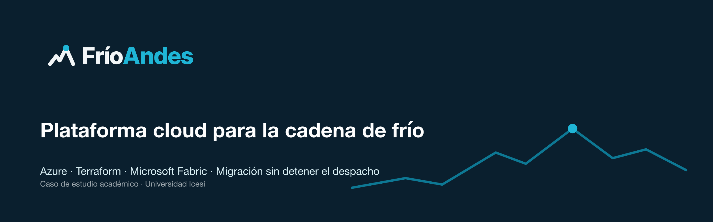

  

  
  
  
  

**FríoAndes** opera la cadena de frío de alimentos desde un datacenter en Cali, con ocho centros regionales, 32 cuartos fríos, 120 camiones y una torre de control que despacha de 04:00 a 22:00. Aquí está la estrategia completa para llevar esa operación a **Microsoft Azure** sin detener el despacho:

- una plataforma logística nueva;
- la telemetría de temperatura en tiempo casi real;
- la migración del núcleo y del archivo de 1,2 PB;
- **Microsoft Fabric** para que la torre de control use inteligencia artificial.

### 📦 Repositorios

| Repositorio | Qué contiene |
|---|---|
| [**planning**](https://github.com/frioandes-platform/planning) | Arquitectura, costos, gestión del cambio, sistema de diseño, cronograma y el informe de la estrategia, con el tablero del proyecto |
| [**iac**](https://github.com/frioandes-platform/iac) | Infraestructura como código en Terraform: módulos reutilizables y ambientes de desarrollo, pruebas y producción |

### 🧊 La solución en una vista

  

| | |
|---|---|
| 🏛️ **Gobierno** | Landing zone con cinco suscripciones, Azure Policy, etiquetas y facturación interna por línea de costo |
| 🔐 **Seguridad** | Entra ID con MFA y PIM, un Key Vault por ambiente, WAF en el portal y auditoría de accesos por cinco años |
| 🌐 **Red híbrida** | Hub y spoke con VPN activo-activo y Azure Firewall; los centros van directo a Azure y la torre queda fuera de internet |
| 🚚 **Cargas** | Container Apps y MySQL 8.4 con réplica en Central US; IoT Hub y Stream Analytics para alertar una excursión en menos de un minuto |
| 📀 **Migración** | Un solo corte, el 14 de febrero de 2027, y el archivo de 1,2 PB sembrado en 71 discos con Import/Export |
| 📈 **Observabilidad** | Azure Monitor, dos objetivos de servicio (portal 99,9 % y alerta en 60 s) y transición desde Zabbix |
| 🤖 **Fabric** | Aviso temprano de excursión, hora estimada de llegada y revisión de fotos de entrega, sin copiar el archivo |
| 🎨 **Diseño** | Un sistema común para la torre de noche, el portal de día y las notas de versión |

### 📄 Entregables

| Documento | |
|---|---|
| Informe de la estrategia | [`report.pdf`](https://github.com/frioandes-platform/planning/blob/main/docs/presentation/report.pdf) |
| Documento de arquitectura | [`architecture-frioandes.pdf`](https://github.com/frioandes-platform/planning/blob/main/docs/architecture/architecture-frioandes.pdf) |
| Documento de costos | [`costs-frioandes.pdf`](https://github.com/frioandes-platform/planning/blob/main/docs/costs/costs-frioandes.pdf) |
| Plantillas de notas de versión | [`docs/change`](https://github.com/frioandes-platform/planning/tree/main/docs/change) |
| Sistema de diseño | [`docs/design`](https://github.com/frioandes-platform/planning/tree/main/docs/design) |

### 🗓️ Hitos

| | Fecha |
|---|---|
| Diseño y presupuesto aprobados | 13 de noviembre de 2026 |
| Día 0: inicio de la convivencia | 11 de enero de 2027 |
| Corte | 14 de febrero de 2027 |
| Cali apagada | 14 de marzo de 2027 |
| Cierre del proyecto | 30 de abril de 2027 |

### 👥 Equipo

  
  
  
  

Caso de estudio académico · Universidad Icesi
